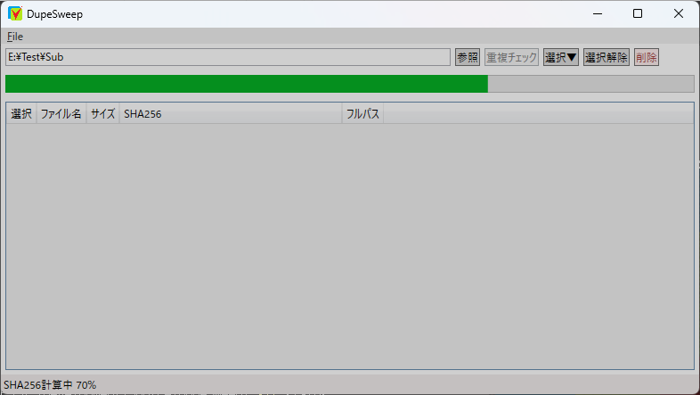
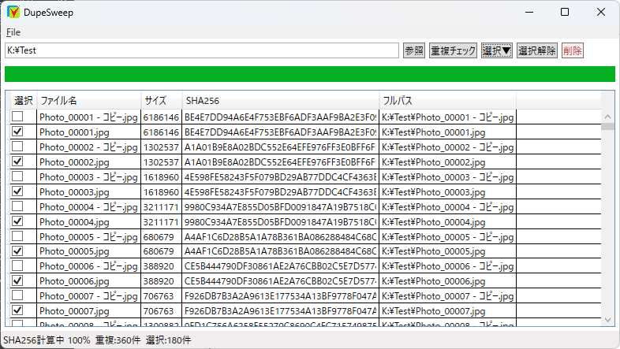

# DupeSweep

Windows向けの重複ファイル検索・整理ツールです。

DupeSweep は SHA256 ハッシュを利用して重複ファイルを検出し、安全な整理をサポートします。

## 特徴

- SHA256 による高精度な重複判定
- フォルダを指定して高速スキャン
- 重複ファイル一覧表示
- 各グループ1件を残して一括選択
- 選択解除機能
- 重複ファイルの退避機能
- スキャン進捗表示
- 削除進捗表示
- 重複件数・選択件数のリアルタイム表示

## 開発環境

- .NET 10
- C#
- WPF
- Visual Studio 2022

## 動作イメージ

### 重複ファイル検索

### 重複ファイル選択

## 使い方

1. フォルダを選択
2. スキャンを実行
3. 重複ファイルを確認
4. 不要なファイルを選択
5. 退避を実行

## 退避先

削除対象のファイルは直接削除されず、以下のフォルダへ移動されます。

`C:\Temp\DuplicateTrash`

必要に応じて退避されたファイルを復元できます。

## 安全設計

DupeSweep は内容比較に SHA256 を使用しています。

ファイル名ではなくファイル内容そのものを比較するため、名前の異なる同一ファイルも検出できます。

重複ファイルの整理時は即時削除ではなく退避フォルダへ移動するため、誤操作時の復元にも対応できます。

## 技術的なポイント

- SHA256 を利用した重複判定
- Parallel.ForEach による並列ハッシュ計算
- WPF デスクトップアプリケーション
- リアルタイムの進捗表示
- MVVM を意識した構成

## 今後の予定

- 除外フォルダ設定
- ファイル種別フィルタ
- スキャン履歴保存
- ドラッグ＆ドロップ対応

## 作者

個人開発プロジェクト
